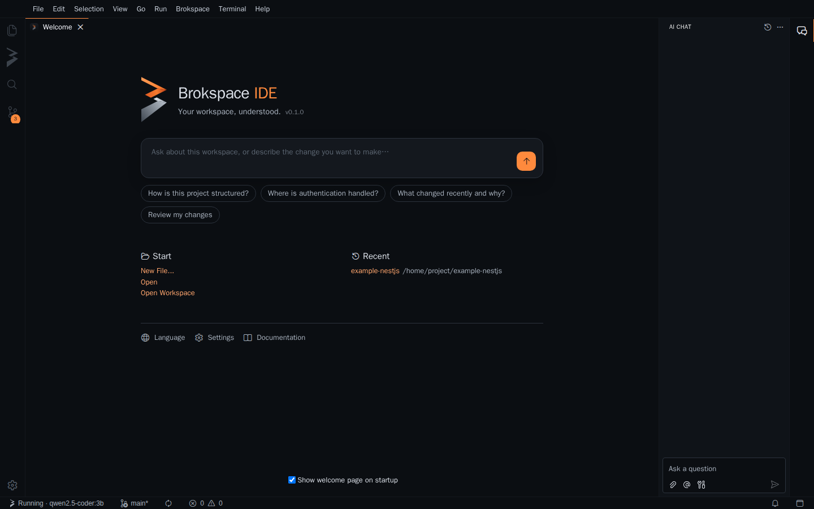

Brokspace IDE is built on [Eclipse Theia](https://theia-ide.org), so VS
Code extensions from [Open VSX](https://open-vsx.org) work in it. It ships
with `brok` and `brok-agent`, and puts them on your `PATH`.



## Install

<Tabs items={['macOS', 'Debian / Ubuntu', 'Linux (other)', 'Windows']}>
  <Tab value="macOS">
    ```sh
    brew install --cask brokspace/tap/brokspace-ide
    ```
    The first launch needs right click > **Open** while the app is not
    notarized yet.
  </Tab>
  <Tab value="Debian / Ubuntu">
    ```sh
    curl -fsSL https://brokspace.github.io/apt/brokspace-archive-keyring.gpg \
      | sudo tee /usr/share/keyrings/brokspace-archive-keyring.gpg >/dev/null
    echo "deb [signed-by=/usr/share/keyrings/brokspace-archive-keyring.gpg] https://brokspace.github.io/apt stable main" \
      | sudo tee /etc/apt/sources.list.d/brokspace.list
    sudo apt update && sudo apt install brokspace-ide
    ```
  </Tab>
  <Tab value="Linux (other)">
    Download the AppImage or the `.tar.gz` from the
    [latest release](https://github.com/brokspace/ide/releases/latest).
  </Tab>
  <Tab value="Windows">
    Download `BrokspaceIDE-<version>-windows-x64-setup.exe` from the
    [latest release](https://github.com/brokspace/ide/releases/latest). Choose
    **More info > Run anyway** in SmartScreen while the installer is not
    signed yet.
  </Tab>
</Tabs>

The IDE updates itself from GitHub Releases. For answers you need an LLM:
see [Local LLM setup](/docs/local-llm) (search works without one).

## Your first minutes

1. **Open a folder** (File > Open Folder). If it has no Brokspace workspace
   yet, the Brokspace view offers **Set Up Workspace**: it runs `brok init`
   for you.
2. **Ask.** Type a question on the home page, or open the chat: the
   **Brokspace** agent answers from your LLM with the sources it used; click
   a source to open the file at that line. Follow-up questions keep the
   conversation.
3. **Search.** The Brokspace view (the folded "B" in the activity bar) finds
   code by meaning or by name; click a result to open it.
4. **Review and commit.** Type `/review` in the chat (or `/review staged`,
   `/review base main`). In Source Control, the ✨ button writes the commit
   message from the staged changes.

## The Brokspace agent

| Type | It runs |
|---|---|
| A question | `brok ask` with the conversation so far |
| `/review` | A review of your uncommitted changes |
| `/review staged` | A review of the staged changes |
| `/review base <ref>` | A review of this branch against `<ref>` |
| `/skill <name> <input>` | A skill on your LLM, e.g. `/skill tdd add a priority field` |

## Commands

Everything is also in the **Brokspace** menu and the command palette:
Set Up Workspace, Start / Stop / Restart, Rebuild Index, Doctor, Install
Shard, Export Skills to Coding Agents, Run Skill, Review, Write Commit
Message. The status bar shows whether Brokspace is running and which model
it uses.

## How it works

The IDE talks to Brokspace only through the `brok` CLI and its JSON output
(see [Integrations](/docs/integrations)), so it shows exactly what `brok`
sees, and anything it does you can also do in a terminal. It needs brok
0.2.4 or newer; the one it ships with qualifies.
