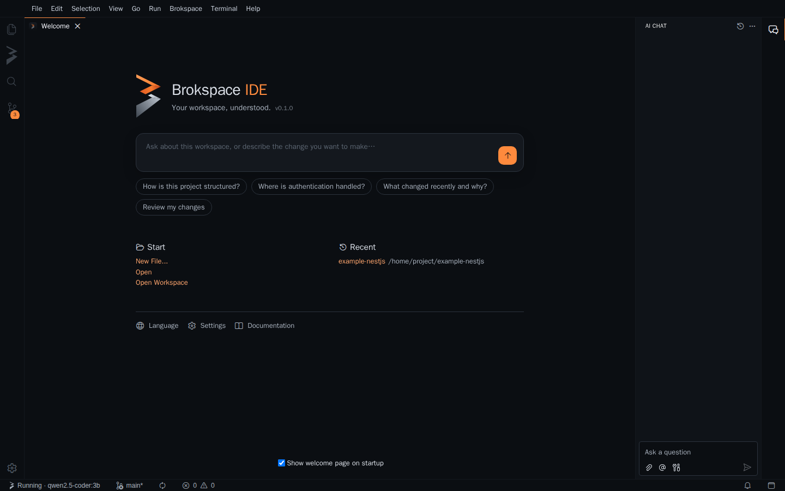

A Brokspace IDE é feita sobre o [Eclipse Theia](https://theia-ide.org),
então extensões do VS Code do [Open VSX](https://open-vsx.org) funcionam
nela. Ela já vem com o `brok` e o `brok-agent` e os coloca no seu `PATH`.



## Instalação

<Tabs items={['macOS', 'Debian / Ubuntu', 'Linux (outros)', 'Windows']}>
  <Tab value="macOS">
    ```sh
    brew install --cask brokspace/tap/brokspace-ide
    ```
    Na primeira vez, abra com clique direito > **Abrir** enquanto o app ainda
    não é notarizado.
  </Tab>
  <Tab value="Debian / Ubuntu">
    ```sh
    curl -fsSL https://brokspace.github.io/apt/brokspace-archive-keyring.gpg \
      | sudo tee /usr/share/keyrings/brokspace-archive-keyring.gpg >/dev/null
    echo "deb [signed-by=/usr/share/keyrings/brokspace-archive-keyring.gpg] https://brokspace.github.io/apt stable main" \
      | sudo tee /etc/apt/sources.list.d/brokspace.list
    sudo apt update && sudo apt install brokspace-ide
    ```
  </Tab>
  <Tab value="Linux (outros)">
    Baixe o AppImage ou o `.tar.gz` da
    [versão mais recente](https://github.com/brokspace/ide/releases/latest).
  </Tab>
  <Tab value="Windows">
    Baixe `BrokspaceIDE-<versão>-windows-x64-setup.exe` da
    [versão mais recente](https://github.com/brokspace/ide/releases/latest).
    No SmartScreen, escolha **Mais informações > Executar assim mesmo**
    enquanto o instalador ainda não é assinado.
  </Tab>
</Tabs>

A IDE se atualiza sozinha pelo GitHub Releases. Para receber respostas
escritas você precisa de um LLM: veja [LLM local](/pt-br/docs/local-llm) (a
busca funciona sem ele).

## Seus primeiros minutos

A janela começa enxuta: Explorer, Busca, Controle de Código-Fonte e Brokspace
à esquerda, e o **agente Brokspace** fixo à direita. Depuração, Testes e
Extensões ficam a um atalho de distância.

1. **Abra uma pasta** (Arquivo > Abrir Pasta). Se ela ainda não tem um
   workspace Brokspace, a visão Brokspace oferece **Configurar Workspace**:
   ela roda `brok init` para você.
2. **Pergunte.** Digite uma pergunta na página inicial ou no painel do
   agente: o agente Brokspace responde com o seu LLM e cita as fontes usadas;
   clique em uma fonte para abrir o arquivo naquela linha. Perguntas de
   acompanhamento mantêm a conversa. Pressione `Ctrl+Shift+A`
   (`Cmd+Shift+A` no macOS) para o **modo foco no agente**, em que o agente
   ocupa a maior parte da janela.
3. **Busque.** A visão Brokspace (o "B" dobrado na barra de atividades)
   encontra código pelo significado ou pelo nome; clique em um resultado para
   abri-lo.
4. **Revise e faça commit.** Digite `/review` no chat (ou `/review staged`,
   `/review base main`). No Controle de Código-Fonte, o botão ✨ escreve a
   mensagem de commit a partir das alterações preparadas.

## A visão Brokspace

| Seção | O que mostra |
|---|---|
| **Visão Geral** | Se o Brokspace está rodando, o modelo, o índice, a busca e Perguntar / Revisar / Commit |
| **Shards** | Cada shard instalado e seu estado; expanda um para ver o que ele lê e escreve, se usa a rede, os programas que executa, os eventos que escuta e publica, e de onde veio. Instale, crie ou remova shards pela barra de ferramentas |
| **Skills** | Fluxos de trabalho que você executa e as skills que seus agentes usam; clique para executar |

## O agente Brokspace

Toda solicitação passa pelo `brok`, que a envia ao LLM definido em
`.brokspace/brok.yml` (Ollama, LM Studio ou uma API hospedada compatível com
OpenAI). Sem um LLM, ou quando ele não responde, o agente responde com o que
o índice local encontrou, em forma de links.

| Digite | Ele executa |
|---|---|
| Uma pergunta | `brok ask` com a conversa até aqui |
| `/review` | Uma revisão das suas alterações não commitadas |
| `/review staged` | Uma revisão das alterações preparadas |
| `/review base <ref>` | Uma revisão deste branch em relação a `<ref>` |
| `/skill <nome> <entrada>` | Uma skill no seu LLM, por exemplo `/skill tdd adicionar um campo de prioridade` |

## Comandos e idiomas

Tudo também está no menu **Brokspace** e na paleta de comandos: Configurar
Workspace, Iniciar / Parar / Reiniciar, Reconstruir Índice, Diagnóstico,
Instalar, Criar e Remover Shard, Exportar Skills para Agentes de Código,
Executar Skill, Revisar, Escrever Mensagem de Commit. A barra de status
mostra se o Brokspace está rodando e qual modelo ele usa.

A IDE está em inglês e em português do Brasil. Ela começa em português em um
sistema em português; troque em **Idioma** na página inicial.

## Como funciona

A IDE conversa com o Brokspace apenas pela CLI `brok` e sua saída JSON (veja
[Integrações](/pt-br/docs/integrations)), então ela mostra exatamente o que o
`brok` vê, e tudo o que ela faz você também pode fazer em um terminal. Ela
precisa do brok 0.2.4 ou mais recente; o que vem com ela atende.
